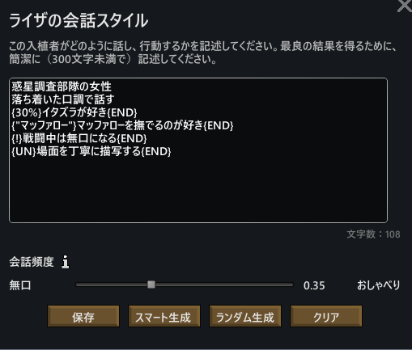
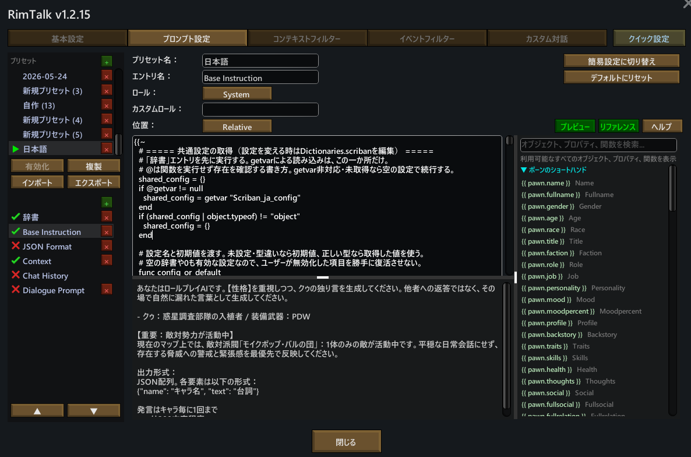
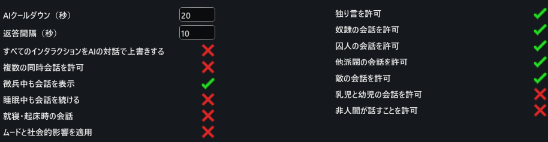
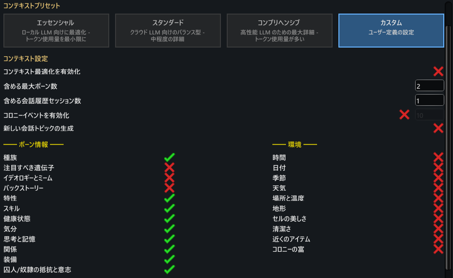

# RimTalk用 日本語Scribanテンプレート

ポーンの性格・人間関係・現在の状況を的確に把握し、より自然で状況に合った日本語会話を生成しやすくするためのテンプレートです。

## 導入手順

1. RimTalkのプロンプト設定画面で新しいプロンプトプリセットを作成します。その後「有効化」ボタンを押します。
2. `JSON Format`、`Recent Events`、`Chat History`、`Dialogue Prompt` の4つの設定を**オフ**にします。
3. エントリ側の緑色の＋ボタンを押し、新たにエントリを追加した後　`Dictionaries.scriban` の全文を貼り付け、最上部へ移動させます。
4. `Base Instruction` の入力欄を `System.scriban` の全文で上書きし、Role（ロール）を `System` に設定します。
5. `Context` の入力欄を `User.scriban` の全文で上書きし、Role（ロール）を `User` に設定します。
6. その他のRimTalkの設定は、後述の「おすすめ設定」の画像に合わせてください。

> `Chat History` をオフにしていても、過去のAI会話履歴は【直前の会話】としてテンプレート側からAIへ渡されます。履歴の取得件数を1以上に設定すると反映されます。

### よくあるエラー

#### [RimTalk] Request failed: 400 - [400] * GenerateContentRequest.contents: contents is not specified
`Base Instruction`や`Context`のロール設定が正しく行われていない可能性があります。
または、使用しているLLMのスペックが足りず、正しいJSONを返せていない可能性があります。Gemma 4以上のモデルを推奨します。

### ペルソナ設定の条件記法

以下の専用構文を使うことで、ポーンのペルソナ（性格設定）を特定の条件でのみ反映させることができます。
**【記述時のルール】**
必ず改行を入れ、**1行につき1つの設定**を記述してください。
特殊構文は半角の`{}`と`%`、大文字の`END`を使い、**1行につき特殊構文は1個**、入れ子やAND／ORの複合条件には対応していません。

| 構文 | 反映される条件 |
| --- | --- |
| `落ち着いた口調で話す` | 常に反映（通常のペルソナ設定と同じ） |
| `{30%}イタズラが好き{END}` | 指定した確率（例：30%）で反映 |
| `{"マッファロー"}マッファローを撫でるのが好き{END}` | 本人の情報（特性・健康・作業・場所・欲求・人間関係など）に指定キーワードが含まれる時のみ反映 |
| `{!}戦闘中は無口になる{END}` | 会話参加者の誰かが戦闘・被弾・徴兵による作戦行動等の状況の時反映（結果は全員で共有） |
| `{UN}場面を丁寧に描写する{END}` | ユニークシーン（UN）発火時のみ反映 |
| `{UNWP}相手を見つめて呟く{END}` | UN発火時で、かつ交流の相手を特定できた時だけ反映 |



### ユニークシーン（UN、UNWP）について

用途がなければ不要な機能です
過去の交流履歴や現在の作業から、「特定の相手とサッカーをしていた場面」のような特別な場面を再現する機能です。
テンプレートは`UN_keyword`辞書に一致する行を次の順で検索します。

1. RimTalk標準の交流ログ（新しい順に最大5件）
2. 独自履歴の検索（対象名を含む新しいログから、`UN_interaction_count`の件数まで）
3. 現在の作業内容

見つかった場合、その文章が【現在の場面】として表示され、会話は場面描写へ切り替わります。交流の相手を一意に特定できた時は「相手は◯◯の仲間「カリア」です。」のような補足も付きます。
戦闘中・参加者に徴兵中のポーンがいる時・探索向けマップでは自動的に抑制されます。

`Dictionaries.scriban` で設定できます。

## カスタマイズについて

`Dictionaries.scriban` にユーザーが任意で変更できる「辞書」と設定がまとまっています。各項目のコメント（説明文）を参考に、必要な部分のみ編集してください。
辞書の項目の共通書式は次のとおりです。

```text
"検索キー": { value: "置換・表示する文字列", chance: 100, mode: "partial" },
```

* `chance`：0〜100の表示・採用確率。当選時は必ず置換し、落選時はその項目を表示しません。
* `mode`：置換範囲。`partial`は一致した部分だけ、`full`は本文全体を置換します。
* `value`が空の場合は、その項目を削除・非表示にします（辞書ごとの詳細は各コメントを参照）。

**【主なカスタマイズ項目】**

* プロンプトに含める特性の絞り込み
* 除外・短縮したい健康状態（怪我や病気）の指定
* 作業内容の不要語の削除・表記揺れの統一
* AIが知らない敵対派閥やMOD追加種族の補足説明
* 派閥名やトレーダー種別の表示名の変更
* 欲求・天候・マップイベント・バイオーム情報の表示確率の調整
* UN（ユニークシーン）の発火率・対象性別と年齢・検出する場面辞書・発言回数の設定
* 室内・外気の温度表示のしきい値と表示確率の調整
* 戦闘終了後の「直近の交戦記録」の表示確率（`recent_combat_history_chance`）の設定

## 注意事項

* **プロンプトの確認方法:** 正しくプロンプトが生成されているかは、一度LLMに情報を送信した後、プロンプト設定画面の「プレビュー」ボタンを押すことで確認できます。
* **プレビュー画面の挙動について:** テキスト生成時に乱数を使用しているため、プレビュー画面を開いたままにすると**表示内容が細かく切り替わったり、チラついたり**する場合があります。



* **辞書の編集について:** テンプレート内の辞書を編集する際は、入力ミスを防ぐため、VS Codeなどの外部テキストエディタで編集してから全文をコピー＆ペーストすることを推奨します。
* **エラー時の挙動:** 構文エラー等が発生すると、テンプレートのソースコードがそのままプロンプトとしてLLMに送信されてしまうことがあります。編集後は必ずプレビュー画面で正常に展開されているか確認してください。
* **AIモデルによる差異:** 会話の自然さや指示への忠実度は、使用するLLM（AIモデル）によって変動します。（おすすめは Gemini 3.5 Flash Lite / RPD: 500 です）
* **敵の数の仕様:** プロンプトに渡される「敵情報」はマップ全体を集計したものです。そのため、ポーンの目の前にいる交戦相手の数とは一致しないことがあります。
* **環境による違い:** 導入している他のMODやRimTalk本体の設定により、取得できる情報や名称が変化する場合があります。

## おすすめ設定（RimTalk v1.4.5時点）




## 機能一覧

#### 1. 自然な日本語台詞の生成

LLMに渡す情報を適切に取捨選択し、プロンプトを日本語で統一することで、LLMがより自然な日本語の台詞を出力しやすくなります。

#### 2. 「独り言」と「会話」の明確な区別

周囲に誰もいない場合は自然な独り言を、2人以上いる場合は相手の発言に対する返答や繋がりを意識した会話を生成するようAIに促します。

#### 3. 立場や敵対関係の反映

入植者・訪問者・囚人・奴隷・敵対勢力などの立場を区別してプロンプトに渡します。これにより、敵対している者同士が不自然に友好的な会話をしてしまう事態を防ぎます。

#### 4. 夫婦・家族関係の反映

会話相手や作業の対象が家族である場合、その人物関係を抽出しプロンプトに含めます。これにより、夫婦や親族ならではの親密な会話が生まれやすくなります。

#### 5. 子供らしい反応の強調

12歳以下のポーンに対しては、年齢相応の語彙・判断力・感情表現を用いて会話を生成するように特別な指示を出します。

#### 6. 戦闘中の緊迫感の演出

交戦状態にある時は平穏な日常会話を制限し、攻撃時の掛け声、周囲への警戒、切迫した感情表現を優先して出力させます。

#### 7. 装備情報の適切な出し入れ

装備している武器の情報は、同じマップに活動中の敵対勢力がいる場合だけ会話へ反映させ、衣服情報は省略します。平和な日常時に突然武器の話をし始めるのを防ぎます。

#### 8. 怪我と失血死の危険性の反映

直近に負った怪我、全身の健康状態、重度の出血や死亡予測などをAIに伝えます。また、内部時間（Tick）制御により、「昔の古傷について延々と話し続ける」といった不自然な挙動を防止します。

#### 9. 喧嘩中・喧嘩直後の険悪な空気の再現

入植者同士の「喧嘩（ソーシャルファイト）」を通常の戦闘とは区別します。喧嘩が終わった後も、怒りや気まずさ、喧嘩で負った怪我への不満などを会話に反映させます。

#### 10. 遺体の適切な認識

運搬や解体の対象が「遺体」である場合、単なるアイテムとしてではなく、生前の名前・種別・所属派閥・敵味方などの補足情報を付与し、生きた人間と取り違えるのを防ぎます。

```text
【作業内容】
ポーチを運搬中
作業対象の補足：ポーチという人間の遺体（プレイヤー陣営に敵対／所属派閥「モイクポ」）

```

人間・動物・メカノイド・異常存在（アノマリー）だけでなく、MODで追加された人型エイリアン種族にも対応しています。

#### 11. 場所や環境の整理

現在地が室内か屋外か、どの部屋にいるのかを整理して伝えます。温度情報は極端な環境下でのみ表示し、室内・外気それぞれの表示しきい値と確率は設定で調整できます。宇宙空間（軌道上）にいる場合は無意味な外気温の情報を省略します。

#### 12. 天気に関する話題の頻度調整

「快晴」や「雨」といったありふれた天候の情報はLLMに渡す確率を下げ、嵐などの特殊な天候や危険な環境情報を優先的に伝えます。天気の話題ばかりになるのを抑えます。

#### 13. マップイベントの反映

太陽フレアやサイコドローンなどのイベント発生状況を伝えます。対象の性別が限定されるイベントの場合、影響を受けるポーンにのみ情報を表示します。

#### 14. 周辺状況（バイオーム・勢力）の反映

プレイヤー入植者の会話生成時、現在地のバイオームや、マップ上にいる敵対勢力・トレーダーの種類などの周辺環境を必要に応じて伝えます。

#### 15. ユニークシーン（UN）の描写

過去の交流ログや特定の作業に基づく特別な場面をAIへ提示し、会話をその場面描写へ切り替えます。交流の相手を特定できた時は、相手の所属や関係も補足します。（設定は「ユニークシーン（UN）について」の節を参照）

#### 16. 特殊マップ向けの指示切り替え

地底（古代の貯蔵庫・虫の巣穴・ピットゲート内部など）や宇宙（小惑星・軌道施設など）、迷宮などの特別なマップでは、メインの指示を探索・調査・回収向けへ切り替え、場所の表示を1行へ短縮します。表示名は辞書で変更・非表示にできます。

#### 17. 搭乗状況の反映

Exosuit FrameworkなどのMODの機体に搭乗しているポーンには「◯◯に搭乗中です。」を伝え、機体の説明文を末尾へ一度だけ添えます。

#### 18. シャンブラーの一貫した扱い

シャンブラーについては元の名前や動物名を表示せず、作業本文・対象補足・戦闘・UNなどの場面の一貫して「シャンブラー」として扱います。

#### 19. 直近の交戦の名残

安全になったマップでは、設定した確率で直近1日以内の交戦相手の情報を表示し、「さっき戦ったばかり」という雰囲気を会話へ反映します。
